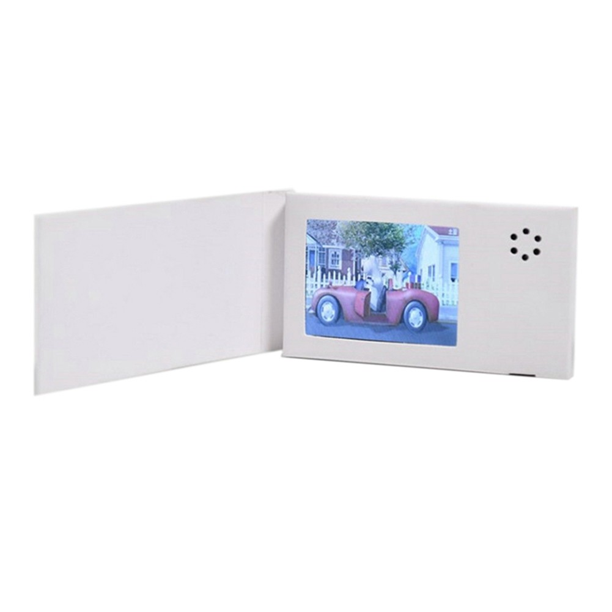
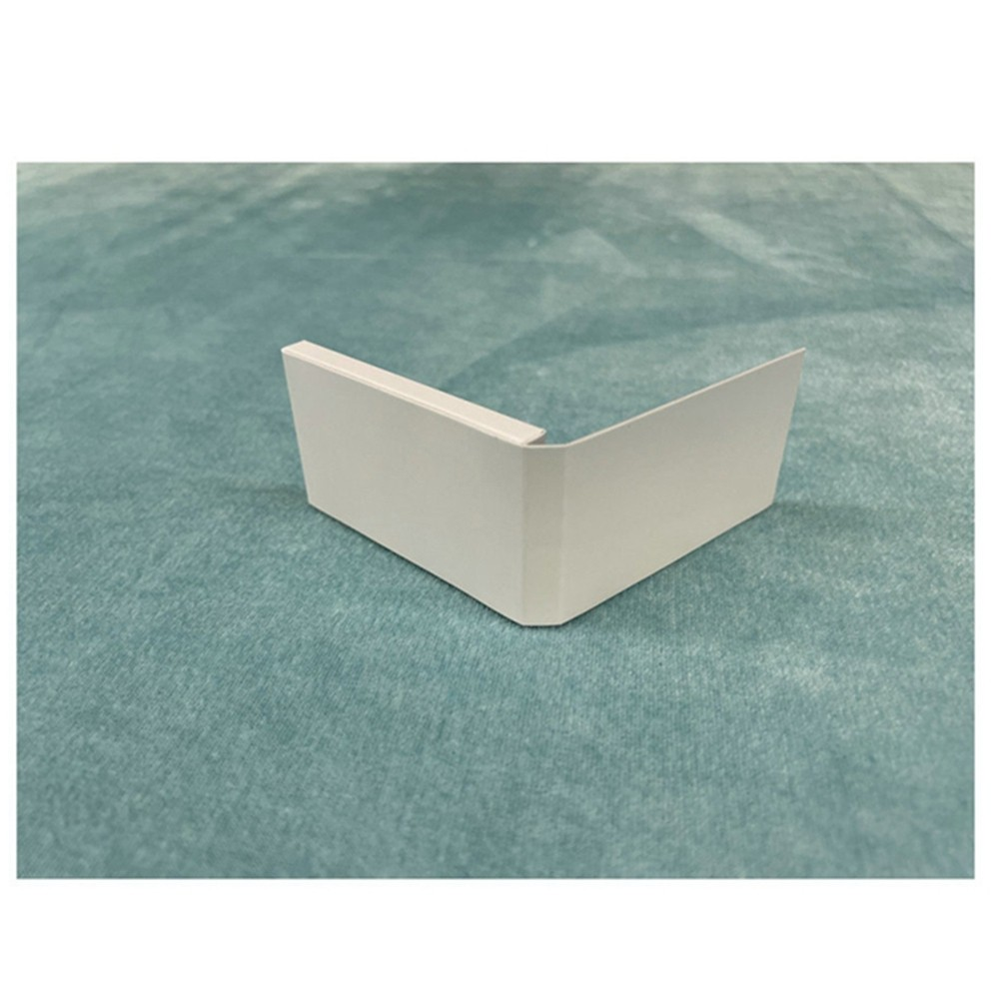

# 2.4-inch LCD AVI Converter





Convert an MP4 (or another video format supported by FFmpeg) into the unusual AVI format used by some inexpensive **2.4-inch, 320x240 LCD media players**. No installation of the vendor's sketchy Windows conversion app is required.

> [!IMPORTANT]
> This is a **device-specific converter**, not a general AVI preset. It requires a known-working `video.avi` from your own device as a template. Compatibility with other devices, and with videos longer than the reference clip, has not been established. I have provided the video.avi file that came with my version but you should replace it with yours if you think your hardware is different.
[video.avi](video.avi)

## Background

The included vendor instructions specify 4:3 AVI at 320x240, but those settings alone are not enough. Ordinary FFmpeg AVI exports produced a "format error" on the tested player.

Inspection and testing of a known-working file revealed the following requirements:

| Property | Working format |
| --- | --- |
| Container | AVI with device-specific header and chunk layout |
| Video | Motion JPEG (MJPEG), `AVI1` identifier |
| Size | 320x240 (4:3) |
| Pixel format | `yuvj420p` |
| Frame rate | Approximately 21.68 fps |
| Audio | IMA ADPCM, mono |
| Audio sample rate | 22,050 Hz |
| Audio block size | 512 bytes |
| Chunk alignment | 4 bytes |

The script uses FFmpeg to encode the picture and audio, then assembles the AVI using the header structure of a video that is already known to play on the device.

## Requirements

- Python 3
- Pillow: pip install pillow
- [FFmpeg](https://ffmpeg.org/download.html), including `ffprobe`, available on your `PATH`
- The **original, known-working** `video.avi` from your LCD player or you can try the one from mine [video.avi](video.avi)
- `lcd_avi_converter.py` from this repository

Confirm that the tools are available:

```bash
python --version
ffmpeg -version
ffprobe -version
```

On some systems, the Python command is `python3` instead of `python`.

## Quick start

Place the original working AVI beside the script:

```text
lcd-avi-converter/
├── lcd_avi_converter.py
├── video.avi                 # Your original, working device video
└── my_video.mp4              # Video to convert
```

Specify a different output name:

```bash
python lcd_avi_converter.py my_video.mp4 converted.avi
```

On Windows, you can use a quoted path, for example:

```powershell
python lcd_avi_converter.py "C:\Videos\clip.mp4" "C:\Videos\clip_device.avi" --template "C:\LCD\video.avi"
```

Copy the resulting `.avi` file to the device's storage and test playback. **Keep a backup of the original `video.avi` and `VIDEO.LIB` somewhere off of the device.**

## What the script does

1. Decodes the input with FFmpeg, scales it into a 320x240 frame while retaining its aspect ratio, and adds black padding where necessary.
2. Pollow encodes the frames as JPEG and changes the JPEG identifier from `JFIF` to `AVI1`.
3. Converts the input audio to 22,050 Hz mono IMA ADPCM in 512-byte blocks. If the source has no audio, it inserts silence.
4. Interleaves the new video frames and audio blocks using the device-compatible AVI chunk layout, 4-byte padding, and an updated frame index.
5. Writes a new AVI. The original template is read but not modified.

The target frame rate is approximately **21.68 fps**. The output is not intended for standard modern media playback or high-quality archival use.

## Compatibility and testing

This tool was developed by comparing a working AVI against failed conversions and testing files on the actual LCD screen. The following were **confirmed to play** on that device:

- A file with replacement MJPEG picture frames embedded in the original AVI structure.
- A file with replacement ADPCM audio embedded in the original AVI structure.
- A hybrid file containing both replacement picture and audio.
- A shortened hybrid file that stopped at the intended point.

The standalone script follows the approach used for those tests. **Its output still needs to be tested on your device**, especially for longer clips. An AVI that plays in FFmpeg or VLC is not necessarily accepted by this hardware.

## Troubleshooting

**"Format error" on the LCD:** Confirm that the `video.avi` template itself plays on the device. Test a short clip first. Different firmware revisions may require different layouts.

**`ffmpeg` or `ffprobe` not found:** Install FFmpeg and add its executable directory to your system's `PATH`, then open a new terminal.

**"The template is not the expected device-compatible AVI":** This tool currently recognizes the specific AVI structure used during development. Use the original known-working file from the same device; arbitrary AVI files cannot serve as templates.

**Audio/video synchronization is off:** The script assigns one 512-byte audio block per video frame at the expected frame timing. Some source formats or device firmware may behave differently.

**Video is letterboxed:** That is intentional. The converter preserves the source aspect ratio instead of stretching a widescreen video into 4:3. Start with a 4:3 video source to fill the screen.

## Limitations

- Designed around **one observed device AVI layout**, not a documented manufacturer specification.
- Videos longer than the template's original content have not been confirmed to work.
- Only the first video stream and first audio stream are used.
- The output uses a fixed target frame rate and a fixed ADPCM block layout.
- The proprietary `VIDEO.LIB` file has not been fully reverse-engineered. No changes to it are required by the demonstrated tests.

## Disclaimer

This is an independent compatibility workaround based on observed file structure and hardware testing. It is not affiliated with, endorsed by, or supported by the device manufacturer. Back up the files on your device before experimenting.
